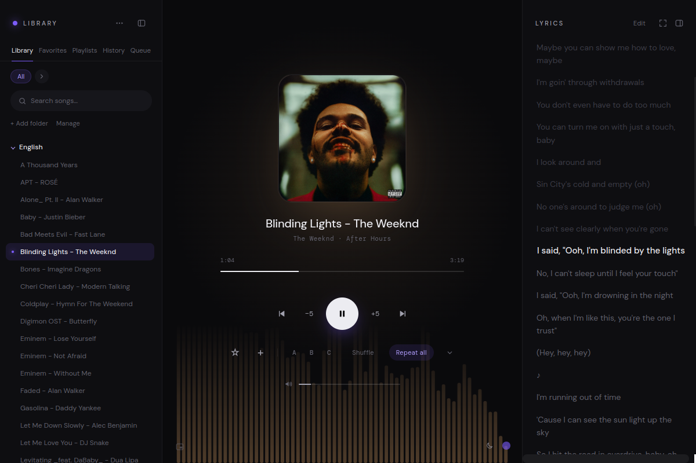
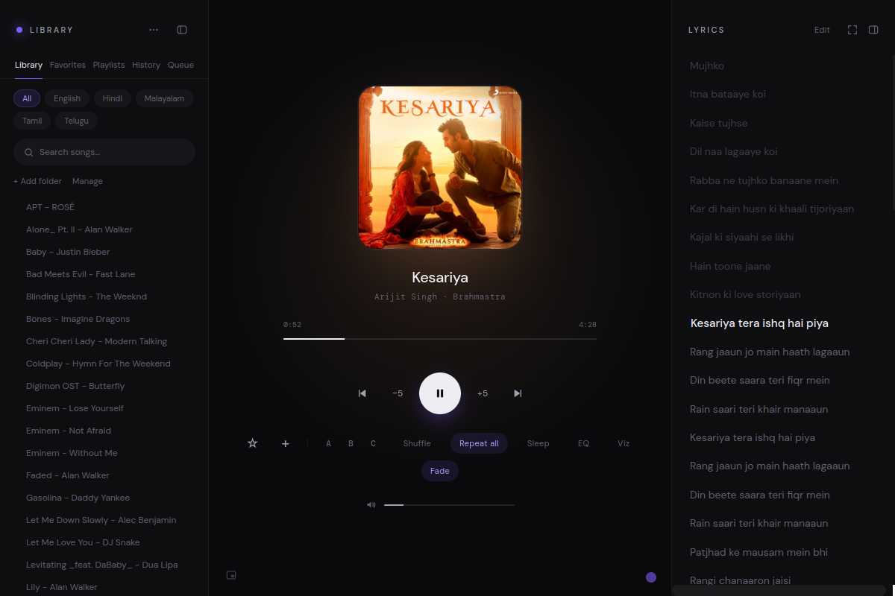
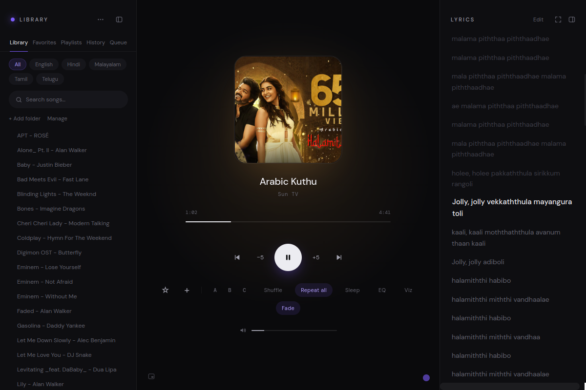
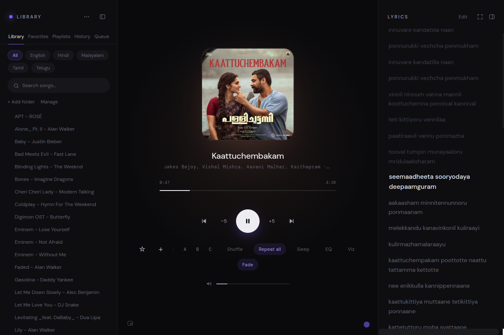
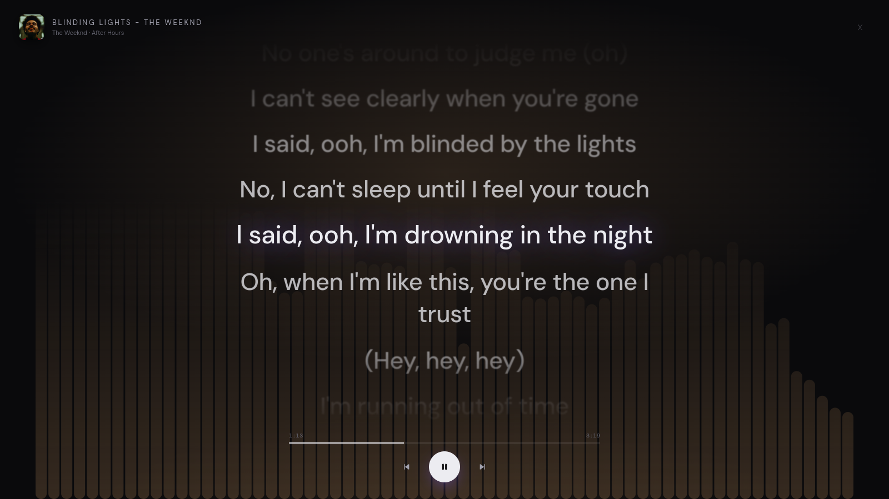
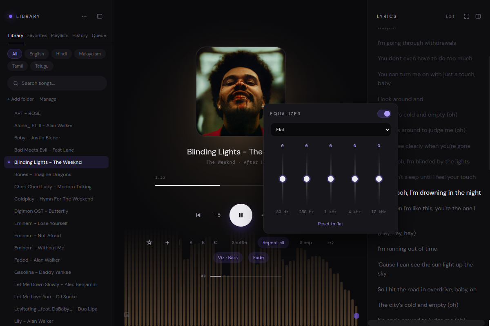
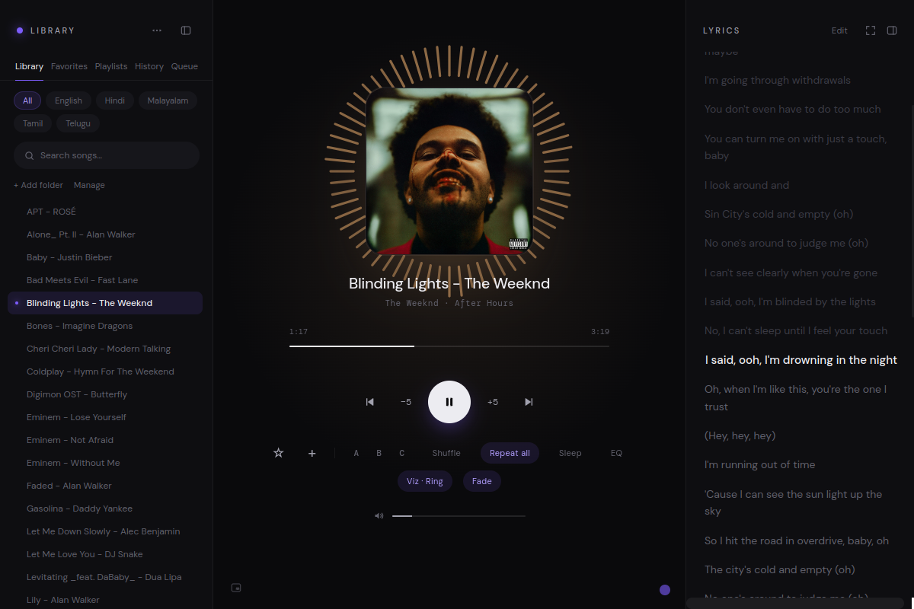
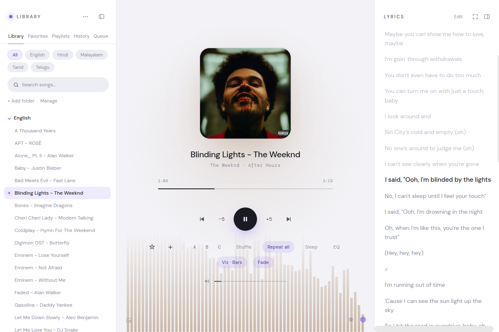
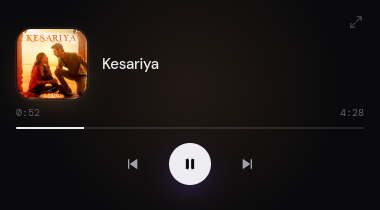

<div align="center">


# Serien Music Player

**A beautiful, local-first desktop music player for Linux, with lyrics that find themselves.**

Play your own library, and every song gets time-synced, scrolling lyrics automatically, even Hindi, Tamil, Telugu, Malayalam and other Indian-language songs, shown in readable English letters.



</div>

---

## ✨ Auto Lyrics: the headline feature

Press play. That's it. No searching, no copy-pasting, no clicking *Fetch*.

When you start a song that has no saved lyrics, Serien looks them up in the background (via the free, open [LRCLIB](https://lrclib.net) database), picks the best match, and shows them **synced to the music**: the current line is highlighted and the panel scrolls along as the singer goes.

- 🎯 **Smart matching.** It reads the song's embedded tags (artist, title, album) and the track duration first. If tags are missing it cleans up the filename (`"Song (Official Video) [HD]"` → `"Song"`) and falls back to fuzzy search. It prefers synced versions, then the closest duration, and rejects results whose length is far off, so you don't get lyrics for the wrong song.
- ⏱️ **Time-synced, karaoke style.** The active line lights up and scrolls into view. **Click any line to jump the song to that moment.**
- 🔤 **Any Indian script, in English letters.** Lyrics written in Devanagari, Tamil, Telugu, Malayalam, Kannada, Bengali, Gujarati or Gurmukhi are romanized on the spot, offline, so you can sing along without reading the script. When an already-romanized version exists, Serien prefers it.
- 🖥️ **Full-screen lyrics mode.** Press **L** for a big, centered lyrics view with album art, seek bar and controls, perfect for a second monitor or a party.
- ✏️ **Yours to edit.** Switch any lyrics to edit mode, fix a line, and save. Saved lyrics are kept locally and used instead of fetching again.

<table>
  <tr>
    <td width="33%"></td>
    <td width="33%"></td>
    <td width="33%"></td>
  </tr>
  <tr>
    <td align="center"><b>Hindi</b><br>Kesariya</td>
    <td align="center"><b>Tamil</b><br>Arabic Kuthu</td>
    <td align="center"><b>Malayalam</b><br>Kaattuchembakam</td>
  </tr>
</table>



> Lyrics lookup needs an internet connection. Everything else, including the romanization, works offline.

---

## 🎧 Everything else it does

| | |
| :--- | :--- |
| **Formats** | MP3, FLAC, WAV, M4A, OGG, AAC, played through [Howler.js](https://howlerjs.com) |
| **Album art & tags** | Reads embedded cover art, artist and album, or `cover.jpg` / `folder.jpg` next to the files. The cover's colors become the glow behind the player |
| **Library** | Add any folders, including other drives. Browse by folder, search instantly, and filter by language with a collapsible chip list (click the `›` next to **All**) |
| **Indic search** | Type `kesariya` and find `केसरिया`. Search 8 Indian scripts using plain English keystrokes, powered by [`@indic-transliteration/sanscript`](https://github.com/indic-transliteration/sanscript.js) |
| **Favorites & playlists** | Star songs, group favorites into categories, create and rename playlists |
| **Queue, history, most played** | A persistent play queue, recently played list and play counts |
| **A–B loop** | Mark a start and end point and loop a passage, handy for learning a song |
| **Tidy controls** | Sleep timer, equalizer, visualizer and fade tuck away behind a `⌄` button and slide out as a second row when you need them. Open or closed is remembered |
| **Sleep timer** | 5 to 90 minutes |
| **Fade in/out** | Smooth fades on play, pause and sleep timer |
| **Shuffle & repeat** | Shuffle and repeat-all |
| **Duplicate finder** | Finds identical files across folders using SHA-1 content hashes |
| **Backup & restore** | Export or import playlists, favorites, history and lyrics as one JSON file, with path remapping when your music lives somewhere else |
| **Linux integration** | Hardware media keys, plus MPRIS (sound menu, lock screen) through the Media Session API |
| **Light & dark mode** | One-click switch (sun/moon button, bottom right, or **T**), remembered between launches |
| **Accent color** | Pick any accent color with the dot in the bottom-right corner |

### 🎛️ Equalizer

A 5-band graphic EQ (80 Hz, 250 Hz, 1 kHz, 4 kHz, 10 kHz) with presets (Bass boost, Treble boost, Vocal, Rock, Pop, Classical, Loudness, Flat), a preamp and a peak limiter, built on the Web Audio API.



### 📊 Visualizer

Real-time spectrum visualization in three styles: **Bars**, **Wave** and **Ring**. Press **V** to cycle through them.



### 🌗 Light & dark mode

Switch themes with the sun/moon button or **T**. Your choice is remembered, and works together with the accent color picker. The screenshot also shows the language list and the extra controls row expanded.



### 🪟 Mini-player

Collapse into a small always-on-top window with the cover, progress and transport controls. **Ctrl + Shift + M** toggles it, and **Esc** brings the full window back.

<p align="center"></p>

---

## ⌨️ Keyboard shortcuts

| Shortcut | Action |
| :--- | :--- |
| **Space** | Play / pause |
| **← / →** | Seek −5 s / +5 s |
| **Ctrl + ← / →** | Previous / next track |
| **↑ / ↓** | Next / previous track |
| **S** | Stop |
| **M** | Mute |
| **F** | Toggle favorite |
| **A / B / C** | Set loop start / set loop end / clear loop |
| **Ctrl + S** | Toggle shuffle |
| **T** | Switch light / dark mode |
| **V** | Cycle visualizer (Off → Bars → Wave → Ring) |
| **L** | Full-screen lyrics (**Esc** to close) |
| **Ctrl + L** | Show / hide the lyrics panel |
| **Ctrl + B** | Show / hide the sidebar |
| **Ctrl + Shift + M** | Toggle the mini-player |

---

## 🚀 Getting started

### Requirements

- [Node.js](https://nodejs.org/) 18 or newer, with `npm`
- Linux (developed on Fedora). The code has macOS and Windows paths too, but they are untested.

### Install and run

```bash
git clone https://github.com/aditya-kumar-k/serien-music-player.git
cd serien-music-player
npm install
npm start
```

Or use the launcher script, which works from any directory: `./launch.sh`

### Add your music

1. Click **+ Add folder** in the sidebar and choose a folder with music (subfolders are included).
2. Repeat for other folders or drives. Use **Manage** to remove folders.
3. Pick a song. Lyrics appear on the right.

Your folders, favorites, playlists, history and lyrics are stored as JSON files next to the app and are ignored by git, so they never end up in the repository. The `*.example.json` files show the format.

### Add it to your app launcher

```bash
./install.sh
```

This creates `~/.local/share/applications/serien-music-player.desktop` pointing at the folder you cloned into, so the player shows up in your launcher.

---

## 🗂️ Project structure

```text
├── main.js              # Electron main process: window, mini-player, dialogs, drive scanning
├── renderer.js          # Playback, library, playlists, favorites, lyrics fetch + sync
├── index.html           # Player layout
├── styles.css           # Dark theme, animations, layout
├── extras.js            # Tags & cover art, queue, history, toasts, fades, full-screen lyrics, media session
├── eq.js                # 5-band equalizer and limiter
├── visualizer.js        # Canvas visualizers (bars, wave, ring)
├── library-tools.js     # Duplicate finder, backup & restore
├── translit.js          # Offline romanization of Indic scripts
├── launch.sh            # Launcher script
├── install.sh           # Installs the launcher entry
├── music-player.desktop.in # Desktop entry template used by install.sh
├── android/             # Android app (Capacitor)
├── docs/screenshots/    # Images used in this README
└── *.example.json       # Sample data files (your real ones are git-ignored)
```

## 📱 Android

The Android app lives in [`android/`](android/). It is a [Capacitor](https://capacitorjs.com) port of the player with MediaStore library scanning, background playback, a home-screen widget and a touch UI. Package id: `com.sereinmusicplayer.app`.

**Download:** [serein-music-player.apk](https://github.com/aditya-kumar-k/serein-music-player/releases/latest/download/serein-music-player.apk) (latest release; see all versions on the [Releases page](https://github.com/aditya-kumar-k/serein-music-player/releases)). Open the file on your phone and allow "Install unknown apps" for your browser or file manager when asked.

**Build a release APK** (needs JDK 21 and the Android SDK with API 36):

```bash
cd android
npm install
npm run build:mobile                 # copy web files and sync Capacitor
echo "sdk.dir=$HOME/Android/Sdk" > android/local.properties
cd android && JAVA_HOME=/path/to/jdk21 ./gradlew assembleRelease
```

The APK is written to `android/android/app/build/outputs/apk/release/`. Release signing reads `android/android/keystore.properties` (`storeFile`, `storePassword`, `keyAlias`, `keyPassword`). Keystores, passwords and APKs are git-ignored, so never commit them. `npm run build:apk` re-signs with `SEREIN_KS_PASS` set.

## 🧰 Built with

[Electron](https://www.electronjs.org/) · [Howler.js](https://howlerjs.com) · [music-metadata](https://github.com/Borewit/music-metadata) · [Sanscript](https://github.com/indic-transliteration/sanscript.js) · [LRCLIB](https://lrclib.net) for lyrics

## 📄 License

[ISC](LICENSE) © Aditya Kumar K
